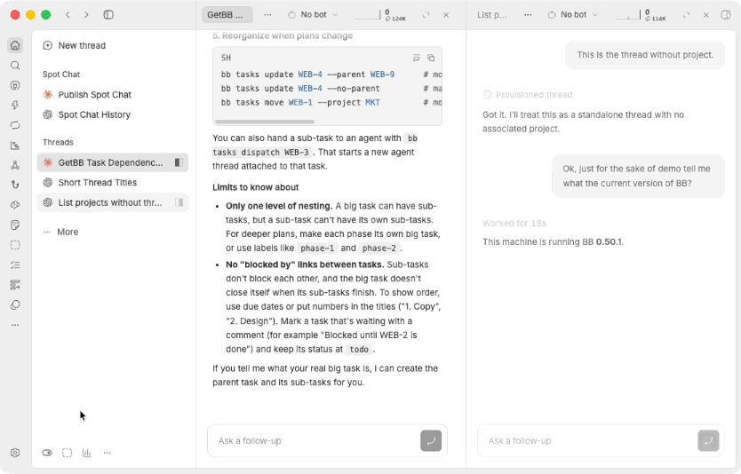
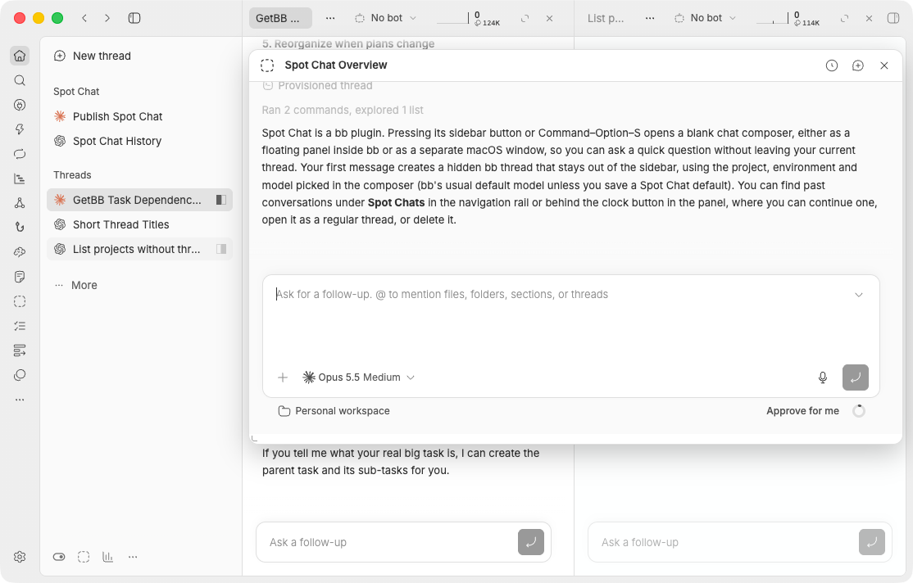
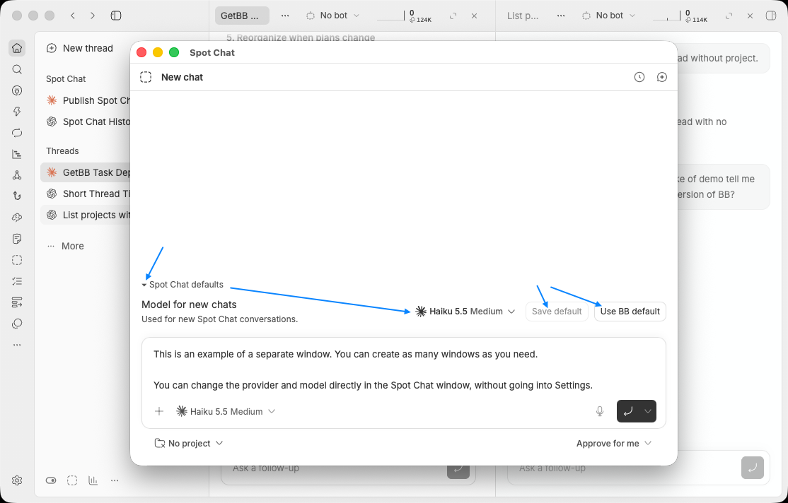
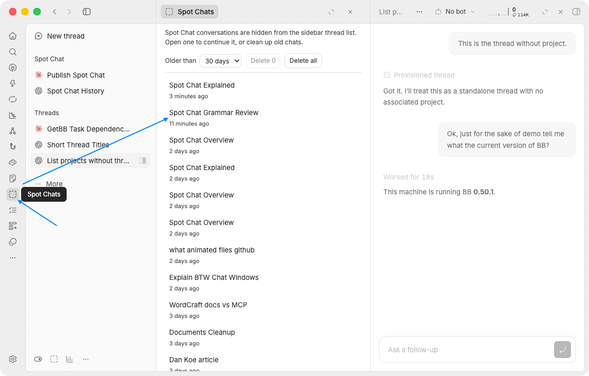
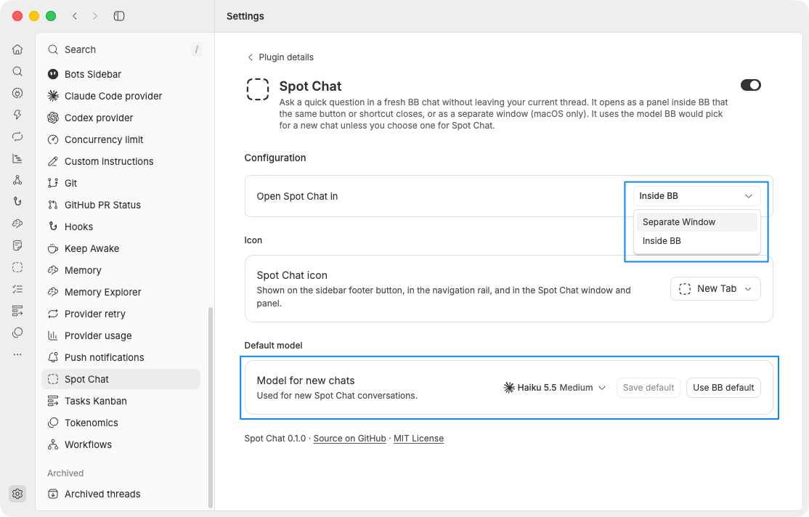

# Spot Chat

A BB plugin that opens a fresh chat in a floating panel or a separate macOS
window, so a quick question does not interrupt the thread you are in.



## Install

```sh
bb plugin install git:https://github.com/FeelsGoodEtc/bb-plugin-spot-chat@^0.1.2
```

BB builds the plugin on install. Requires bb 0.50 or later.

## Use

The Spot Chat button in BB's left sidebar and Command–Option–S open a fresh BB
composer. Choose the mode under **Settings → Spot Chat → Open Spot Chat in**.
The shortcut is configurable under **Settings → Keyboard → Spot Chat: new window**.
The shortcut follows the physical keys, so it also works on layouts such as
Russian, where macOS reports Command–Option–S as another letter.
Choose Spot Chat's icon under **Settings → Spot Chat → Icon** from BB's built-in
icon set. It appears on the sidebar footer button, in the navigation rail, and in
the Spot Chat window and panel header.

- **Inside BB** (default) opens a floating panel. Pressing the button or
  shortcut again closes it. It appears at the right below BB's title bar. It
  starts above the underlying composer, when present. Resize it from the left
  edge, bottom edge, or bottom-left corner. The panel saves its own size in
  that BB client.
- **Separate Window** opens a resizable macOS window inside the BB window
  that opened it, at its right edge and below BB's title bar. It restores its
  last resized dimensions, fitted to the BB window, or starts at one third of
  the BB window's width.

Each launch gets a blank draft. Sending the first message creates a hidden BB
thread, using the project, environment and model chosen in the composer. Hidden
threads stay out of the sidebar thread list.

Find past conversations in two places:

- **Spot Chats** (the chosen icon) in BB's navigation rail lists every Spot Chat
  conversation. Open one to continue it there, or choose **Open as thread**.
- The clock button in the Spot Chat header shows the same list inside the
  window. Picking a conversation continues it in that window; the new-chat button
  starts a blank draft.

Both lists delete a single conversation (trash icon, click twice), every
conversation older than 7, 30 or 90 days, or all of them. Each delete asks for a
second click.

By default Spot Chat uses the model BB would pick for a new chat without a
project: the provider and model you last used there, otherwise BB's default
provider and its default model. To pin a provider, model and reasoning level,
use **Settings → Spot Chat → Default model** or open **Spot Chat defaults**
above the composer and select **Save default**. The composer's own model
picker changes only the current conversation. **Use BB default** clears the
saved Spot Chat preference.

**Separate Window** loads the loopback BB server using WebKit. It is only used
from the BB desktop app on the Mac that runs the BB server. Web browsers, the
mobile app, and desktop apps connected to another machine always open
**Inside BB**, whatever the setting says. The Inside BB panel remembers its size
separately in each browser or app.

## Screenshots

**Inside BB** — a floating panel over the current thread:



**Separate Window** (macOS) — with Spot Chat defaults open above the composer:



**Spot Chats** in the navigation rail lists every conversation:



**Settings → Spot Chat**:



## Native window

**Separate Window** runs `macos/Spot Chat.app`, a prebuilt universal app
(arm64 and x86_64, macOS 12 or later) committed to this repository with an
ad-hoc signature. It contains only `macos/SpotChat.swift` compiled with
`macos/build.sh`. If the app is missing, Spot Chat shows an error that suggests
switching to **Inside BB**.

To rebuild it, install the Xcode Command Line Tools and run:

```sh
sh macos/build.sh
```

## Experimental APIs

Spot Chat relies on parts of BB that may change without notice:

- experimental Plugin SDK APIs (names starting with `experimental_`): the
  new-thread composer, provider/model picker, app overlay and sidebar footer
  slots, icon registry, RPC query hooks and cache invalidation, and select
  option labels;
- the undocumented `window.bbDesktop` property, used to detect the BB desktop
  app before offering **Separate Window**.

A BB update can break either one until the plugin is updated. When that
happens, choose **Inside BB** or reinstall a newer release.

## Development

```sh
npm ci
node scripts/extract-icons.mjs   # refresh BB's icon list after BB updates
sh macos/build.sh                # only after changing macos/
npm exec -- tsc --noEmit
bb plugin build
bb plugin install . --yes
```

## License

[MIT](LICENSE)
